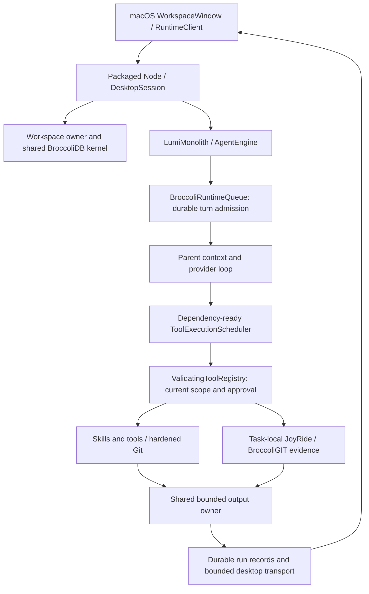

# Runtime throughput, ownership, and recovery

Completed on macOS, October 2–3, 2026. This pass starts from the protected [maturity baseline](RUNTIME-MATURITY.md). It fixes a demonstrated workspace retention path, reduces the parent's measured preparation delay, makes skill discovery cheaper, and gives large tool output one bounded owner. Authority, mutation ordering, durability, and scheduler concurrency remain intact.

Final suites: **459 desktop tests, 220 native tests, and 100 engine/scheduler/recovery/skill tests pass**. The desktop suite has one platform skip. Repository-wide Biome still reports two unrelated pre-existing errors; scoped lint passes. Production packaging and runtime checks pass with an **ad-hoc development signature**, not Developer ID/notarization. Commands, counts, hashes, and evidence are in [runtime-throughput-verification.json](runtime-throughput-verification.json).

Measurement host: Apple M1 Pro, 16 GiB, macOS 26.5.1 (25F80), Git 2.48.1. Packaged runtime measurements use Node 22.22.0; source test tooling uses the installed Node 26.8.1. Exact baseline/final bundle and source hashes are recorded in the verification file. The skill timing samples did not separately record their interpreter version, so no interpreter-specific claim is made for them.

## What actually executes

`WorkspaceWindow` owns its worker. `DesktopSession` owns conversation, approval, cancellation, and workspace evidence. The factory passes the existing kernel and registry into the agent. BroccoliQueue serializes turns with single-attempt recovery; the tool scheduler separately admits dependency-ready calls. Autonomous tool concurrency is still four, interactive concurrency one. A provider round waits for its requested tool batch; independent ready calls within that batch already proceed as slots become available.

The registry independently checks current authorization, approval, arguments, and workspace paths. Skills supply instructions; they do not grant execution rights. A child receives delegated execution options, not authority from a cached result. Git remains authoritative for current repository state. BroccoliGIT observes supported writes without acquiring a mutation executor. BroccoliDB's table/WAL/CAS path remains authoritative persistence. Durable completion is recorded before authoritative delivery; existing bounded progress coalescing remains non-authoritative.

The regenerated [subsystem manifest](runtime-subsystems.json) contains **22 entries: 17 active, two partial, one legacy, two compatibility**. Each has source hashes, instantiation/consumer evidence, ownership, persistence, and authority qualifications. Construction alone is not classified as dynamic verification. The older Spider audit facade and separately callable checkpoint tools are partial integrations. Earlier core JoyRide belongs to another host. Optional database/orchestrator facades remain compatibility exports. No whole exported subsystem was proven orphaned and deleted. Desktop reviewed restore, database checkpoints, and BroccoliGIT observations still have different contracts; combining their names or stores would obscure that distinction.

## Measured blockers and changes

| Demonstrated cause | Minimal change | Measurement and verification |
| --- | --- | --- |
| Parent workspace verification read independent files serially before calling the provider. | Read four files per batch, reserve the same aggregate byte budget before allocation, preserve traversal order, and drain started reads on cancellation. | First tool p50 **368.68 → 202.39 ms** in the real packaged parent fixture; workspace verification and scheduler tests pass. |
| Discovery read all instruction bodies merely to obtain skill metadata. | Read a 4 KiB prefix; fall back to the bounded full read if frontmatter extends beyond it. Activation still freshly reads and validates all required instructions. | **17,284,416 → 262,144 bytes** per 64-file discovery, 98.48% fewer; extended frontmatter and invalid full-body cases tested. |
| Equivalent pending skill activations shared I/O but repeated parsing; abandoned discovery could finish and publish metadata. | Share the validated pending instruction result; cancel discovery when its last consumer leaves; suppress late publication; invalidate workspace metadata at close. | Eight activations still use one full read; survivor cancellation stays independent; cancellation tests end with zero active consumers/keys. |
| BroccoliGIT's completed composite timeout signals retained closed evidence owners on packaged Node 22.22. | One local operation scope owns the controller, deadline timer, and parent subscriptions; all four call sites dispose in `finally`. Check scoped cancellation after direct work. | Baseline retained **60 evidence stores and 60 kernels after 60 closes**; final package retains **zero probed closed owners**. Deadline/cancellation and 100-scope cleanup tests pass. |
| Parent and registry had separate spill stores; returned references could not be retrieved. Long lines bypassed a line-only preview, and large structured results were repeatedly serialized/retained. | Share the registry's governor; bound serialization, previews, entries, total spill ownership, and retrieval pages; clear on turn completion/failure/cancellation/close. | Eight 2 MB controlled structured results: retained result representation **16,001,463 → 3,166 bytes**. Oversized content is explicitly unavailable, not silently archived. Long-line reconstruction, eviction, disabled retention, and lifecycle tests pass. |
| Partial tool output could lose its incompleteness indication in persisted history. | Carry `outputLimited` into the recorded manifest and existing output reader's `truncated` field. | Existing history/native partial-output presentation receives the marker; focused blob test and full desktop suite pass. |
| Near-limit reservations were hard to explain from diagnostics. | Expose metadata reservation, active scratch reservation, remaining capacity, limit, and pending count. | The 16 MiB limit is unchanged; the 1,024-target fixture demonstrates rejection before another capture allocation, with current inspection still usable. |

### Parent and I/O timing

The [before](runtime-parent-before.json) and [after](runtime-parent-after.json) runs use the preserved baseline bundle and final packaged bundle, the actual parent, durable queue, guarded registry, eight real file reads, and workspace verification over 2,000 source files / 9.2 MB. The provider is deterministic and in-process. Each run separates one cold turn from 11 warm turns. These final parent runs were sequential after the heavy fixtures completed; they do not measure network/model inference. p95 is nearest rank, therefore the largest of 11 warm samples.

| Milliseconds, warm p50 / p95 | Before | After |
| --- | ---: | ---: |
| First provider request | 368.22 / 390.92 | 202.05 / 213.89 |
| First useful tool starts | 368.68 / 391.39 | 202.39 / 214.60 |
| Queue admission | 11.99 / 17.85 | 11.78 / 15.79 |
| Admission to context preparation, principally workspace verification | 330.07 / 352.65 | 170.17 / 174.85 |
| Context preparation itself | 0.61 / 0.92 | 0.59 / 0.85 |
| Eight independent reads, first start to last finish | 5.93 / 13.89 | 5.12 / 7.48 |
| Complete controlled turn, including final verification | 713.30 / 798.17 | 402.39 / 420.44 |

Cold first-provider time was **473.31 → 271.72 ms**. The defensible improvement is approximately **45% less time before the first useful tool in this fixture**, explained by verification I/O. Small context/read/admission differences are not independent speedup claims. Persistence still contributes admission time; observed flush-count differences follow existing coalescing timing, not a new durability policy. Provider-round dependencies and mutation conflicts remain sequential where required.

The tradeoff is up to four 2 MiB file buffers instead of one during verification. Its 64 MiB aggregate read cap, 20,000-entry cap, five-second deadline, path validation, and cancellation remain. There is no persistent whole-workspace index or freshness shortcut. A larger repository with one changed path is covered separately by the 52,001-path Git fixture.

### Skills and context

Skill discovery remains metadata-first, activation through `use_skill`, supporting references on demand. In the [64-file fixture](runtime-skills-after.json), each full file is 270,069 bytes. Before/after discovery p50 is **16.21 → 4.69 ms**, p95 **20.83 → 7.24 ms** across 15 measured scans after warm-up. Other diagnostics shared the machine during these skill runs, so the deterministic byte reduction is stronger evidence than the latency ratio. [Baseline samples](runtime-skills-before.json) remain available.

The model-facing catalog remains **5,928 bytes**. Required instructions remain **269,999 bytes** per activation; eight simultaneous consumers use one 270,069-byte read both before and after. The change replaces eight equivalent parses with one. No required instructions were replaced with a summary. Full activation rejects malformed, binary, empty, oversized, or changed content even when the metadata prefix was acceptable. Pending sharing does not become a persistent instruction cache. Workspace close invalidates its metadata; the existing 64-workspace/15-second metadata cache remains bounded.

### Large results and progressive retrieval

One task owns the parent and registry's output store: **2 MiB total conservative UTF-16 plus entry metadata, 512 KiB per entry, at most 16 entries**. String previews are at most 40,000 characters. Retrieval returns at most 16,000 characters / 200 lines with a line-and-character continuation, so a single giant line cannot force an unbounded page. References expire at task end or eviction. Disabled retention does not issue a pretend reference.

Small structured results retain their JSON shape. Serialization visits at most 10,000 nodes and bounds source characters before producing JSON; machine-readable envelopes up to 256 KiB retain their completeness fields. Larger serializable results become an explicit partial preview; content too large to admit receives a valid JSON explanation requesting selected paths, fewer results, or a smaller range. This also fixes the unused table formatter's silent row/column loss by removing it. Worst-case escaping can still produce approximately 3 MiB of temporary serialization text within the source-character bound; this is not a sandbox for hostile getters or custom `toJSON` methods.

The parent's controlled large-output case falls from **2,000,037 to 194 model-facing bytes per result** because those results exceed retention admission. The final provider request is **16,034,134 → 35,796 bytes**; the retained turn result is **16,001,463 → 3,166 bytes**. These are explicit unavailable/partial notices, not lossless compression. Admitted content can be paged; declined content requires a narrower tool request. Execution status and errors remain separate from preview text. Required `use_skill` instructions keep their existing full-read bound and are exempt from generic preview truncation.

The ordinary parent's first request grows by 212 bytes from the now-usable retrieval schema. No new semantic transcript compaction or history replay policy was introduced. The native transport remains independently bounded; packaged Git's six real protocol requests have a largest frame of **196,364 bytes**. The native 100,000-event test held process high-water RSS at **217,104,384 bytes** at its initial, 50,000-event, and 100,000-event measurements. That high-water observation is not a measure of every retained allocation.

## Memory ownership and remaining uncertainty

The old approximately 5.8 MB post-GC increase justified investigation, not a leak declaration. A longer equivalent packaged workload made ownership visible: completed parent/registry/cache owners collected, while every closed BroccoliGIT evidence store and kernel stayed alive. A diagnostic heap snapshot identified this strong path:

`Node gcPersistentSignals → composite AbortSignal → abort reason Error → CallSiteInfo → closed BroccoliGit → evidence store / kernel`

The [sanitized retainer paths](runtime-retainer-paths.json), weak ownership probes, and packaged Node version agree. This is an observed interaction with Node 22.22's composite/timeout signal retention and error stacks, not a claim that every use of `AbortSignal.any` leaks. Replacing only these settled observation scopes with explicitly disposed timers/subscriptions removes the root path without upgrading the runtime or adding a global cancellation framework.

The [baseline](runtime-ownership-before.json) and [final package](runtime-ownership-after.json) run **300 real edit/inspect/checkpoint tasks and 60 factory closes/reopens**, in three equal-history workspaces. Two explicit GCs and an event-loop turn precede each closed sample. Allocation sampling and weak references are diagnostic-only. No provider or GUI is involved in this ownership fixture.

| Closed sample | Before heap used, bytes | After heap used, bytes | Closed evidence stores / kernels still alive, before → after |
| --- | ---: | ---: | --- |
| Task 5 / close 1 | 67,222,680 | 67,036,608 | 1 / 1 → 0 / 0 |
| Task 25 / close 5 | 65,701,960 | 64,853,704 | 5 / 5 → 0 / 0 |
| Task 100 / close 20 | 73,464,808 | 66,340,512 | 20 / 20 → 0 / 0 |
| Task 200 / close 40 | 80,716,648 | 66,604,384 | 40 / 40 → 0 / 0 |
| Task 300 / close 60 | 87,783,880 | 66,736,088 | 60 / 60 → 0 / 0 |

Code/metadata continues warming: **3,384,104 → 3,512,657 bytes** from task 100 to 300; bytecode/metadata is stable at 1,148,560 bytes. Total post-close heap grows **395,576 bytes** over those 200 tasks. This residual is not fully attributed. The measurements support removal of the demonstrated ownership leak and a much smaller steady-state envelope; they do not prove universal leak freedom or assign every residual byte to V8.

After warm-up, post-close RSS is 149,929,984 bytes at task 100, 151,994,368 at 200, and 151,748,608 at 300. RSS before warm-up is substantially higher; allocator/high-water behavior is not itself retained object evidence. Array buffers stay at 76,701 bytes, file descriptors at 13, and process listener counts stay fixed. The sampled `FSReqPromise: 1` is reproduced by the fixture's own `/dev/fd` read in a [runtime-free control](runtime-diagnostic-control.json). Stopping/collecting the allocation profiler changes final heap/RSS again; compare equivalent closed samples, not that instrumented final sample against an idle process.

The scope unit test also disposes 100 operations with no retained deadline timers or added parent/lifetime listeners. Closed owners are all collectable, including runtime, registry, and JoyRide cache. Durable evidence is deliberately retained on disk: approximately 3.86 MB per 100-task workspace and 11.58 MB across three workspaces before fixture cleanup. On-disk retention and hot ownership have different lifetimes.

### Admission and native resources

The [stress fixture](runtime-broccoligit-stress.json) again reaches **16,746,440 bytes / 15.97 MiB** against the unchanged 16 MiB native BroccoliGIT allowance. It explains the boundary instead of increasing it: metadata is conservatively reserved at eight times encoded size plus fixed hot overhead; a before-image capture reserves 12 MiB before I/O. At the degraded observation, metadata reserves 4,251,400 bytes, leaving 12,525,816 bytes, less than the next 12,582,912-byte capture reservation. Therefore 96 of 1,024 known targets are captured and 928 explicitly declined. Smaller current reads/historical requests continue to work. No unavailable baseline is replaced with HEAD.

The 300-task ownership soak peaks at 16,261,280 bytes. These reservations are owned-allocation estimates, not process RSS limits. Safe Git child high-water memory reaches **39,813,120 bytes** in the stress run and is reported separately. Teardown leaves no active Git child, live scratch reservation, pending inspection, retained page, or comparison cache entry. The stress driver imports both bundles plus source storage and deliberately retains comparison fixtures; its approximately 305 MB heap is not a product steady-state measurement.

The actual [four-window packaged native run](runtime-throughput-native-idle.json) was inspected through the existing macOS interface, idled for 60 seconds, and quit normally. Aggregate native/process footprint samples are **722.10, 700.39, 602.81, 602.81, 602.91 MB**. App descriptors stay at 23 and each worker at 14; measured aggregate idle CPU is 1.17% of one core. Normal quit returns zero and leaves zero workers. Other diagnostics were active on this Mac, so this is a lifecycle/bounded-idle observation, not an isolated footprint speedup or overnight soak.

## Cancellation, failures, and restart

Human cancellation still propagates through DesktopSession, parent task scope, scheduler, guarded tool options, and the existing Git subprocess boundary. Skill discovery now stops when its last consumer leaves. An underlying loader that ignores cancellation continues to occupy admission until it settles; no false release or replacement flood is allowed. A surviving coalesced consumer keeps its independent result. Failed dependency inputs block their dependents; unrelated ready work remains eligible under the existing scheduler tests. Approval is not repeated merely to cross these internal boundaries, and reuse never substitutes for current authorization.

The [cancellation fixture](runtime-cancellation-benchmarks.json) measures 20 real Git inspection cancellations and 20 cooperative skill-load cancellations. Git response p50/p95 is **0.227 / 0.511 ms**, complete drain **0.385 / 0.963 ms**, maximum drain **1.194 ms**. Skill drain p50/p95 is **0.046 / 0.123 ms**. These are controlled local timings, not a latency guarantee for tools that ignore their signal. All recorded active operations, waiting consumers, pending keys, and live scratch reservations end at zero.

The [interruption fixture](runtime-interruption-verification.json) SIGKILLs actual runtime processes at eight observed barriers, then reopens them. It instruments production source execution with deterministic barriers; it is not eight GUI process kills or eight live-model sessions.

| Interruption | Reopened result |
| --- | --- |
| Before before-image capture | No invented operation or write; prior checkpoint survives. |
| During tool execution before write | Intent remains unresolved; current bytes unchanged. |
| Immediately after write | Approved bytes present, intent unresolved; no claim that every side effect completed. |
| Before outcome publication | Same uncertain outcome; completion is not fabricated. |
| During checkpoint publication after durable content | Previous complete checkpoint remains; uncommitted publication is not promoted. |
| During Git inspection | Ordinary recovery; no surviving identified Git child. |
| During skill load | Ephemeral load disappears; ordinary recovery remains available. |
| During desktop history persistence | Run is reported interrupted; durable output does not fabricate a completed manifest. |

**All eight recoveries execute zero mutating registry calls.** No missing completion causes replay. The [packaged reference journey](runtime-packaged-journey.json) also passes dirty start, separate staged/unstaged state, raw before-image, authorized write, selected diff, durable checkpoint, restart, and external-edit reconciliation. Failure, deadline, cancellation, unavailable history, partial evidence, and uncertain mutation effects remain distinguishable.

### Git and retained comparison regression measurements

| Warm p50 / p95, ms | Baseline | Final |
| --- | ---: | ---: |
| Selected path in 52,001-file repository | 111.15 / 128.69 | 105.72 / 119.82 |
| Before-image to current | 83.18 / 92.04 | 85.69 / 97.38 |
| Retained checkpoint pair | 0.98 / 9.53 | 0.96 / 1.33 |
| Ordinary resume | 151.43 / 163.53 | 150.42 / 156.20 |
| Resume after 300 edits | 159.08 / 185.17 | 170.57 / 196.98 |

There is **no new Git speedup claim**. The 300-edit resume is about 7% slower in this shared-host measurement; causal attribution/noise remains unresolved. Validation is preserved, and eliminating demonstrated retained owners justifies the scoped lifecycle change independently of a latency gain. Each scenario has one cold sample, two warm-up samples, and nine steady samples. Current-byte verification remains in before/current timing; application byte counters exclude Git's own I/O and CAS verification. The compact 300-edit resume stays **2,996 bytes**. The previous pass's 91.7% diff-generation and 49% context reductions remain baseline achievements.

For 52,001 changed paths, the response is **32,780 bytes**, explicitly partial with a narrower-scope instruction. Large generated/binary files, odd paths, staged/unstaged separation, changed anchors, unavailable content, and external edits remain covered by the Git/BroccoliGIT suite. Finite retained paging is not a claim of constant traversal time.

## Consolidation and ergonomics

Removed one redundant parent output store and the unused automatic table formatter. Four independently constructed deadline scopes now use one owned helper. Pending skill consumers share one parse. The previous nine storage helper consolidations were already baseline work. No broad cache clearing, new transaction manager, background scanner, scheduler, persistent index, or UI surface was added.

The visible improvement is less waiting before useful work, retrievable admitted output, explicit guidance when content was not retained, and a persistent partial marker instead of a deceptively complete history entry. Existing cancellation/recovery language remains on the established surfaces. Four-window inspection showed the active workspace, connection state, ready activity, and disabled Stop control after completion without exposing Broccoli terminology. Navigation did not require a redesign; no new prompts or confirmation loops were introduced.

## Established patterns adopted and rejected

| HEAV3NS-CODE problem | Analogous pattern and applicability | Adaptation / verification |
| --- | --- | --- |
| Skill discovery consumes entire bodies. | [VS Code skill loading](https://code.visualstudio.com/docs/agent-customization/agent-skills) separates discovering relevant skills from loading their instructions and referenced material. | Prefix metadata, complete required body on activation, separate references; exact model bytes and invalidation/cancellation tests. |
| Closed scopes keep owned resources reachable. | Explicit lifecycle cleanup complements cancellation; the [pinned Node implementation](https://github.com/nodejs/node/blob/v22.22.0/lib/internal/abort_controller.js) and measured retainers identify the actual owner. | Local disposable scope, no global replacement framework; closed-object probes and timer/listener tests. |
| Large producers outrun result consumers. | [Node stream backpressure](https://nodejs.org/download/release/v22.22.0/docs/api/stream.html) makes producer/consumer capacity explicit. | Preserve existing transport backpressure; bound tool representation before repeated copies and offer finite pages. No streaming protocol rewrite was needed. |
| RSS growth is ambiguous. | [V8 heap diagnostics](https://nodejs.org/download/release/v22.22.0/docs/api/v8.html) distinguish heap/code statistics and object retainers; snapshots can block and require substantial extra memory. | Opt-in fixture-only snapshots, sanitized paths, equivalent post-GC samples and weak probes; no always-on profiler. |

Rejected: increasing scheduler worker counts (ready work already proceeds); a persistent workspace index (external-edit validity cost is unproven); summaries in place of required skill instructions; an unlimited spill archive; delivering authoritative completion before persistence; retrying uncertain mutations; enlarging the 16 MiB limit; a Node upgrade as a substitute for local lifecycle ownership; and a broad process/state-machine/transport rewrite without a measured blocker. Familiar IDE chrome, automatic staging, and new navigation surfaces did not solve this pass's demonstrated problems.

## Verification and deliberate limits

| Final check | Result |
| --- | --- |
| Full macOS desktop suite, including BroccoliGIT/Git/JoyRide/storage/skills/recovery | **459 pass, 0 fail, 1 platform skip** |
| Native macOS suite | **220 pass, 0 fail, 0 skip** |
| Engine, workspace verification, queue, scheduler, resilience, shared skills | **100 pass, 0 fail, 0 skip** |
| Interruption/reopen fixture | **8 pass, 0 fail** |
| Measured cancellation cases | **20 Git + 20 skills pass** |
| Packaged ownership soak | **300 tasks / 60 reopens pass; zero closed owners remain** |
| Scaling and capacity | **52,001 changed paths; 300 edits; 1,024-target admission; 20 cancellations pass** |
| Packaged reference journey / Git protocol | **Pass / 6 requests pass** |
| TypeScript main and worker; scoped lint (24 files); manifest and diff checks | **Pass** |
| Production macOS build; deep/strict code-signature verification | **Pass, ad-hoc signature** |
| Repository-wide Biome | **2 pre-existing errors; no fixes applied** |
| Developer ID/notarization, live provider timing, Linux release | **Not run** |

Test groups are reported separately, not summed into a misleading unique-test total. Initial reproducers and integration failures were fixed: last-consumer skill cancellation, unusable/oversized output retention, and a too-small structured JSON cap that broke the existing Git envelope. The final full suite uses the corrected cap and passes. Sandbox-limited local server, process memory, and packaged ownership checks were rerun with the required host access; those blocked attempts are not product failures. The unrelated Biome errors are `openrouter-native.test.ts:87` optional chaining and `StateManager.ts:2` an unused import.

Remaining uncertainty is explicit: the final 395,576-byte post-warm-up heap increase is not fully attributed; Git resume timing variation is not causally assigned; macOS idle coverage is 60 seconds, not overnight; deterministic provider timing is not real model throughput. Skill discovery keeps the existing directory enumeration and metadata cache policy; enormous installed-skill catalogs were not redesigned or proven unlimited. Total multi-round provider history is not newly semantically compacted. Temporary producer objects before the governor, native Git memory, shared storage allocations, and Swift state are not all covered by the BroccoliGIT reservation. None of these bounded fixtures proves all-workload memory safety or exactly-once external side effects.

Implementation stops here: measured parent blocking and unnecessary retention have concrete fixes, skill/output ownership is bounded, cancellation/restart evidence is coherent, and the integrated macOS checks pass with the named limitations. Further speculative architecture changes and unrelated lint cleanup are deferred.
